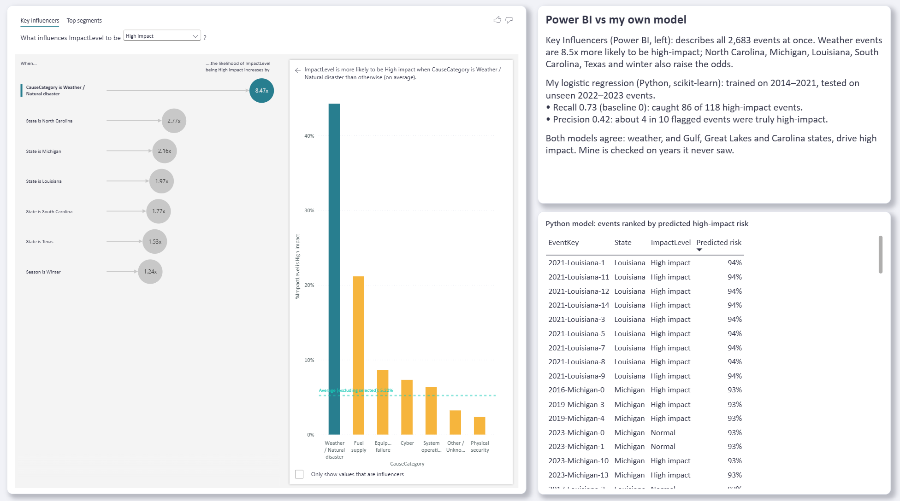

# Grid Reliability: which major outage events become high-impact?

A Power BI report, a small ML model, and two Claude agents built on U.S. power outage data, 2014–2023
(EAGLE-I county-level outage records matched to DOE-417 major disturbance events).

**The question:** when a major event starts, can we flag early which ones will grow into
high-impact events (≥ 500,000 customer-hours without power)?

## What's in the data
- 2,683 major events and 79,711 distinct county outages after de-duplication
- A small share of outages drives most of the impact: high-impact events are roughly
  6% of outages but a third of all customer-hours

## The model (`src/outage_model.py`)
Logistic regression on event attributes (state, weather vs. non-weather, month, ...).
It trains on 2014–2021 and is scored on a held-out 2022–2023 test set it never saw.

| | Recall (high-impact) | Precision |
|---|---|---|
| Baseline (always predict "not high-impact") | 0.00 | – |
| Cross-validated, 2014–2021 | 0.78 | – |
| **Held-out test, 2022–2023** | **0.73** | **0.42** |

The model is tuned for recall: missing a big event costs more than a false alarm.
The strongest drivers are Louisiana, Michigan, Texas and North Carolina, and weather-caused events.

The model writes a risk score for every event to `outputs/event_risk.csv`, and the report's ML page uses it.

## Power BI report (`powerbi/`)
| Overview | Causes | ML |
|---|---|---|
|  |  |  |

Open `powerbi/grid-reliability.pbix` in Power BI Desktop. The theme is `simply-modern-grid.json`.

## The agents
`src/make_events.py` first builds the same clean tables the report uses: `work/events.csv` (one row per
event) and `work/outages.csv` (each county outage once). Known steps go in plain code; the agents get
the questions you can't predict.

### Analyst agent (`src/agent.py`)
Ask a plain-English question; Claude writes pandas code, the program runs it and sends back the output,
and that repeats until it can answer. One tool (`run_python`), one loop, about 70 lines.

**The Texas trap.** Asked "Which state lost the most customer-hours?", the first version added up
events and said Texas, about 2.2 billion: nearly the whole country's real total of 2.55 billion.
Overlapping events (39 Texas filings in February 2021 alone) share the same county outages, so adding
across events counts them again and again. The code ran perfectly; the answer was wrong.
**The fix** was one rule in the instructions: totals and rankings come from `outages.csv`. Now it
answers Florida (about 372 million), just ahead of Texas (about 364 million).

**Guardrails**
- You approve every script before it runs
- Each script runs as a separate process in `work/`, with a 30-second timeout
- Output sent back to the model is capped at 4,000 characters
- A step limit (8) stops runaway loops
- Every step, tool call and token count is logged to `agent_log.jsonl`

**Evaluation.** `src/evals.py` re-runs the agent on 5 questions with known answers (5/5 pass).
Removing the `outages.csv` rule makes the Texas case fail, so it works as a regression test for the prompt.
`tests/test_tools.py` checks the tool itself: output, errors returned instead of crashing, and the timeout.

**Cost.** About 2.5 API calls and $0.014 per question on Claude Sonnet 5.5, measured over 17 questions.
That's about $7,000 a year at 500,000 questions.

### Model coach (`src/coach.py`)
An agent that tunes the outage model like a junior analyst running experiments. It proposes a
setting, code scores it with 5-fold cross-validation on 2014–2021, and it tries again (at most 8 tries,
one change at a time). The model proposes; the metric decides. **The 2022–2023 test years stay
locked**: the agent never sees them, and `coach.py final` scores the chosen setting on them once, by hand.

Goal: the highest recall with precision at 0.50 or above.

| # | Model | Features | Threshold | Recall | Precision | Precision ≥ 0.5? |
|---|---|---|---|---|---|---|
| 1 | logreg (baseline) | Weather, Month, State | 0.50 | 0.782 | 0.509 | yes |
| 2 | random forest | Weather, Month, State | 0.50 | 0.821 | 0.483 | no |
| 3 | random forest | Weather, Month, State | 0.60 | 0.695 | 0.533 | yes |
| 4 | random forest | Weather, Month, State | 0.55 | 0.770 | 0.506 | yes |
| 5 | logreg | Weather, Month, State | 0.48 | 0.800 | 0.505 | yes |
| 6 | logreg | Weather, Month, State | 0.46 | 0.810 | 0.495 | no |
| 7 | **logreg** | **Weather, Month, State** | **0.47** | **0.804** | **0.503** | **yes** |

All settings balanced. The coach picked threshold 0.47 in 2 of 3 runs (0.48 in the other). The random
forest did worse than logistic regression at matched precision, so the simpler model stays.

## Run it
```bash
uv sync
uv run python src/make_events.py      # build work/events.csv and work/outages.csv
uv run python src/outage_model.py     # the model and outputs/event_risk.csv
uv run python src/agent.py "Which state lost the most customer-hours?"
uv run python src/coach.py            # the coach (final: run once, by hand)
uv run python src/evals.py            # score the analyst agent on known answers
uv run python -m pytest               # tool tests (the timeout test takes 30 s)
```
The agents need `ANTHROPIC_API_KEY` in a `.env` file in the repo root. Every script finds its files from
the repo root, so they run from any folder.

## Layout
```
data/       raw outage + event CSVs (2014–2023)
src/        make_events, outage_model, agent, coach, evals
tests/      tool tests
outputs/    model risk scores consumed by the report
powerbi/    report, theme, screenshots
work/       generated tables, charts and scratch scripts (not committed)
```

## Data
EAGLE-I outage data (Oak Ridge National Laboratory / U.S. DOE) joined with DOE-417
electric disturbance event reports.
