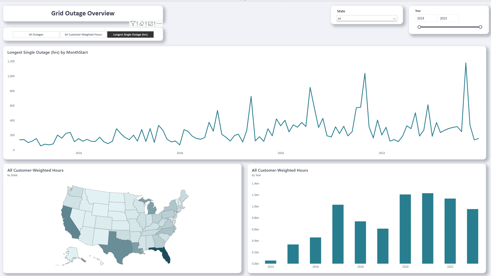
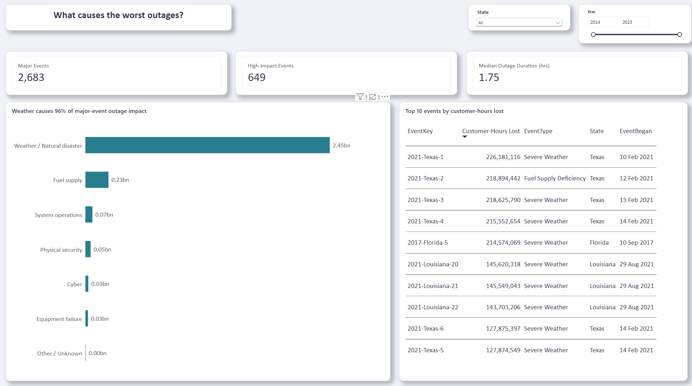

# Grid Reliability: which major outage events become high-impact?

A Power BI report and a small ML model built on U.S. power outage data, 2014–2023
(EAGLE-I county-level outage records matched to DOE-417 major disturbance events).

**The question:** when a major event starts, can we flag early which ones will grow into
high-impact events (≥ 500,000 customer-hours without power)?

## What's in the data
- 2,683 major events and 79,711 distinct county outages after de-duplication
- A small share of outages drives most of the impact: high-impact events are roughly
  6% of outages but a third of all customer-hours

## The model (`src/outage_model.py`)
Logistic regression on event attributes (state, weather vs. non-weather, month, ...).
It trains on 2014–2021 and is scored on a held-out 2022–2023 test set it never saw.

| | Recall (high-impact) | Precision |
|---|---|---|
| Baseline (always predict "not high-impact") | 0.00 | – |
| Cross-validated, 2014–2021 | 0.78 | – |
| **Held-out test, 2022–2023** | **0.73** | **0.42** |

The model is tuned for recall: missing a big event costs more than a false alarm.
The strongest drivers are Louisiana, Michigan, Texas and North Carolina, and weather-caused events.

The model writes a risk score for every event to `outputs/event_risk.csv`, and the report's ML page uses it.

## Power BI report (`powerbi/`)
| Overview | Causes | ML |
|---|---|---|
|  |  |  |

Open `powerbi/grid-reliability.pbix` in Power BI Desktop. The theme is `simply-modern-grid.json`.

## Run it
```bash
uv sync
uv run python src/outage_model.py
```

## Layout
```
data/       raw outage + event CSVs (2014–2023)
src/        model code
outputs/    model risk scores consumed by the report
powerbi/    report, theme, screenshots
```

## Data
EAGLE-I outage data (Oak Ridge National Laboratory / U.S. DOE) joined with DOE-417
electric disturbance event reports.